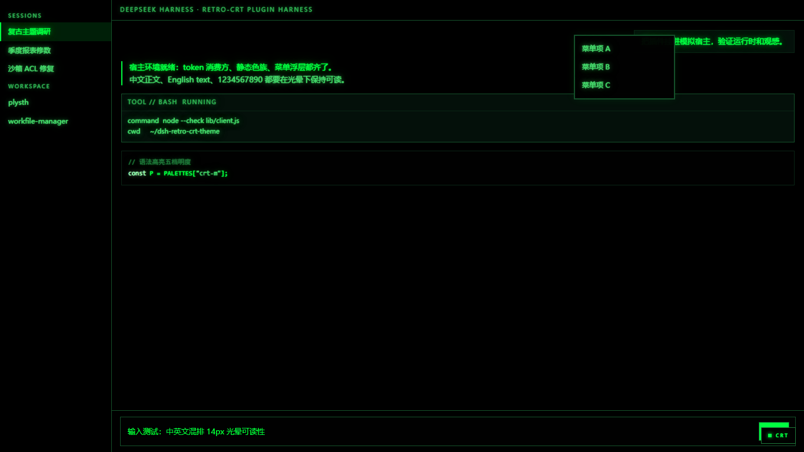
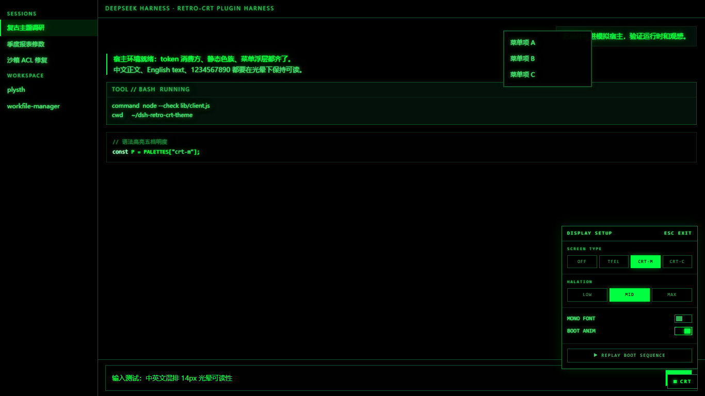

# dsh-retro-crt-theme

**复古 CRT 磷光主题** · Retro CRT Phosphor Theme for DeepSeek Harness

纯黑底、粗胖字、强泛光的 CRT 荧光屏——黑客帝国开场「Wake up, Neo...」的观感，外加一段代码雨开机动画。

A pure-black CRT phosphor theme with bold, glowing text — the look of the Matrix's "Wake up, Neo..." scene, plus a code-rain boot animation.

| 主题效果 Theme | 开机动画 Boot animation | 控制面板 Control panel |
| --- | --- | --- |
|  |  |  |

## 屏种 Screen types

| 屏种 | 世界观 | 主色 |
| --- | --- | --- |
| `CRT·M` | 黑客帝国 P1 磷光绿 Matrix P1 phosphor green | `#00FF41` |
| `CRT·C` | 战锤40K 算神机黄绿（IBM 5151 系）40K cogitator amber-green | `#D9F25E` |
| `TFEL` | 日系车载音响薄膜电致发光琥珀 JDM car-audio TFEL amber | `#FFA028` |
| `OFF` | 原生外观 Native look | — |

## 光晕强度 Halation

- `LOW`：配色 + 贴身微光 palette + tight glow
- `MID`（默认 default）：双实芯撑胖笔画 + 8/22/46px 三层泛光 ——「Wake up, Neo」观感 double solid cores fatten glyphs + three bloom layers
- `MAX`：+ 暗角、刷新带下扫、整屏微 flicker（TFEL 换像素点阵膜）+ vignette, refresh sweep, subtle flicker

## 开关 Toggles

- `MONO FONT`：全局等宽字体 monospace everywhere
- `BOOT ANIM`：开机代码雨（每浏览器会话一次，可重播；任意键跳过；`prefers-reduced-motion` 自动降级）boot code-rain, once per session, replayable, skippable

控制面板在**右下角 `CRT` 按钮**（ESC 关闭）。Control panel: bottom-right `CRT` button (ESC to close).

## 安装 Install

```sh
dsh plugin --profile web add dsh-retro-crt-theme
```

Desktop 端在 **设置 → 插件市场** 安装。Install from Settings → Plugin Market on desktop.

## 实现 Implementation

- 配色经官方扩展点 `ctx.theme.overrideTokens()` 挂到内置 light/dark 之上（CRT 没有白天，两列同值）；不注册第三方 theme id，主题偏好持久化不受影响
- 结构层（halation / 反白 / elevation 溢光 / 方角滚动条 / 静态色族兜底）是一张 `html[data-retro]` 门控的样式表，卸载即净
- 状态存 `localStorage`，纯视觉偏好，不落 Host 配置

Colors ride the official `ctx.theme.overrideTokens()` extension point over built-in light/dark (CRT has no daytime — both columns identical); no third-party theme id is registered, so preference persistence is untouched. Structure CSS (halation / inverted blocks / light-bleed elevation / square scrollbars) is gated by `html[data-retro]` and removed cleanly on uninstall. State lives in `localStorage`.

## 许可 License

MIT
